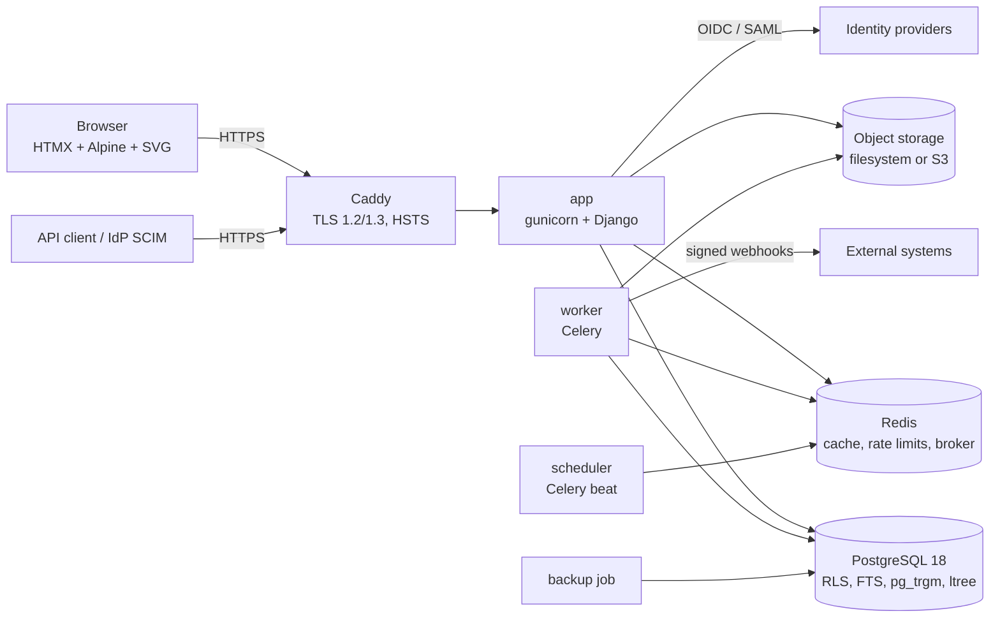

# Architecture

PatchManager is a server-rendered Django application with a REST API, backed only by
PostgreSQL. Every domain record belongs to exactly one tenant. Authorisation is decided
by one central policy service.

## Runtime view



Phase 0 ships `app`, `postgres`, `redis`, `caddy`, `backup` and a `migrate` one-shot.
`worker` and `scheduler` join when the first background job lands (Phase 1, mail).

## Code layout

```
src/patchmanager/
  settings.py        environment driven configuration
  core/              base models (UUIDv7), JSON logging, health endpoints
  tenancy/           tenants, tenant context, RLS session variable     (Phase 1)
  accounts/          users, groups, roles, MFA, sessions, policy engine (Phase 1)
  audit/             hash chained audit log, change history            (Phase 1, 6)
  locations/         site, building, floor, room                       (Phase 2)
  dcim/              racks, devices, ports, rack occupancy              (Phase 2, 3)
  library/           vendors, device types, port templates              (Phase 3)
  cabling/           cables, terminations, path tracing                 (Phase 4)
  networks/          VLANs, WLANs, port assignments                     (Phase 4)
  floorplans/        plan uploads, scale, placements                    (Phase 5)
  exports/           PDF, CSV, XLSX, JSON, import wizard                (Phase 6)
  api/               REST API, tokens, webhooks, SCIM                   (Phase 1, 7)
```

Apps are created when their phase starts, not before.

## Layering rules

1. **Views and API endpoints** parse input, call one service function, render output.
   No queries beyond what the service returns, no permission logic.
2. **Services** (`<app>/services.py`) hold business rules and transactions. They take
   an explicit `actor` and call the policy service.
3. **Selectors** (`<app>/selectors.py`) return querysets already filtered by
   `policy.scope(actor, action, Model)`. UI, API, search and exports use the same
   selectors, so nothing can list objects the actor may not see.
4. **Models** carry constraints. Invariants that the database can enforce (unique
   names, U range overlap, VLAN id range) are database constraints, not Python checks.

## Tenant isolation (two layers)

1. **Application:** every tenant scoped model uses a manager that requires a tenant
   context; selectors always filter by the tenants the actor may access.
2. **Database:** every tenant scoped table has `tenant_id` and a Row Level Security
   policy `tenant_id = ANY(current_setting('patchmanager.tenant_ids')::uuid[])`. A
   middleware sets the variable per request with `SET LOCAL` inside the request
   transaction. The application connects as a role that does not own the tables and
   has no `BYPASSRLS`; migrations run as the owner role.

Tests prove both layers independently: with the application filter disabled, RLS
alone must still hide foreign rows.

## Authorisation model

Evaluated by `accounts.policy` only. Inputs: actor, action, object (or object type
and scope for list queries).

* **Permission:** `<object_type>.<action>`, declared in code, for example
  `dcim.rack.change`, `cabling.cable.trace`, `locations.site.move_tenant`.
* **Role:** named set of permissions. System roles are immutable.
* **Assignment:** `(principal, role, scope, conditions, effect)`. The principal is a
  user or a group (groups nest, cycles rejected). Scope is global, tenant, site,
  building, floor, room, rack or one object. Conditions are a small, validated JSON
  expression (tag equals, owner is actor, status not in list).
* **Inheritance:** each scoped object stores an `ltree` path
  (`tenant.site.building.floor.room.rack`). An assignment at scope `S` covers every
  object whose path is a descendant of `S`.

Evaluation order (deterministic, first match wins):

1. Inactive, locked or deprovisioned actor: deny.
2. Super Admin system role at global scope: allow.
3. Any matching **deny** assignment (scope covers object, conditions true): deny.
4. Any matching **allow** assignment: allow.
5. Otherwise deny.

Results are cached per actor in Redis, keyed by a version counter that bumps on any
role, group or assignment change. An explainer returns the assignments that decided
the outcome, used by the admin "why" view.

## Data flows worth calling out

* **Path trace:** start at a port, follow its cable to the far port; if that port is a
  patch panel front port, continue from its mapped rear port (and the reverse). Stop
  at an active device, an open end or a loop. Implemented iteratively in Python with a
  visited set; a recursive CTE backs bulk traces. Property based tests generate random
  panel chains.
* **Audit log:** append only table, each row stores `sha256(prev_hash || canonical
  row)`. The application role has `INSERT` and `SELECT` only. A verifier walks the
  chain.
