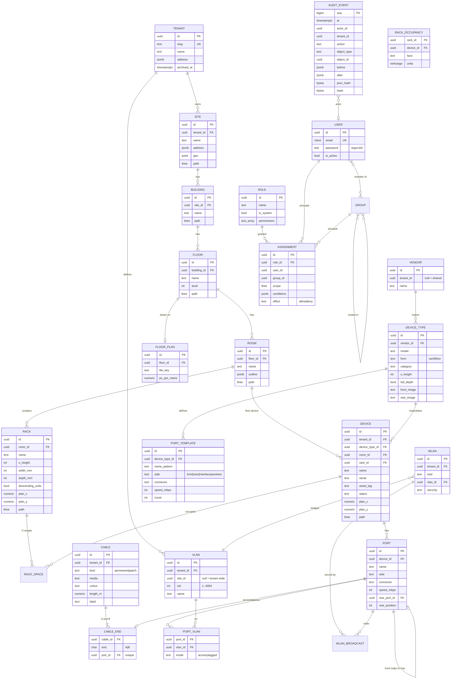

# Data model

Draft for all phases. Each phase refines its part before implementation. All primary
keys are UUIDv7. Every table except `tenant`, the identity tables and instance settings
carries `tenant_id` and an RLS policy.

## Database enforced invariants

| Rule | Mechanism |
|---|---|
| No two things share a U on the same rack face | `EXCLUDE USING gist (rack_id WITH =, faces WITH &&, units WITH &&)` on `dcim_rackspace`; `faces` is `[0,1)` front, `[1,2)` rear, `[0,2)` both |
| Space fits in the rack | trigger `pm_check_rackspace`; trigger `pm_check_rack_height` stops shrinking below used units |
| Child in parent's tenant, path consistent | trigger `pm_check_hierarchy` on every tree table |
| A port has at most one cable | unique `cable_end.port_id` |
| A cable has exactly ends A and B | unique `(cable_id, end)`, deferred check for count = 2 |
| VLAN id range and uniqueness | `CHECK (vid BETWEEN 1 AND 4094)`, unique `(tenant_id, coalesce(site_id), vid)` |
| Names unique within parent | unique `(parent_id, lower(name))` |
| Cross tenant references impossible | composite foreign keys `(tenant_id, parent_id)` referencing `(tenant_id, id)` |
| Audit log append only | `REVOKE UPDATE, DELETE`; trigger rejects both |

## Search

Each searchable table gets a generated `tsvector` column (`simple` config, so names
and serials are not stemmed) with a GIN index, plus `gin_trgm_ops` indexes on name,
serial and asset tag for fuzzy matching. Global search unions per type selectors, so
results are already permission and tenant filtered.

## Generic attachments

Photos, notes and tags attach to any object through `(object_type, object_id)` plus
`tenant_id`. Files are stored by content hash; metadata rows hold MIME type, size and
the sanitised derivative key.
