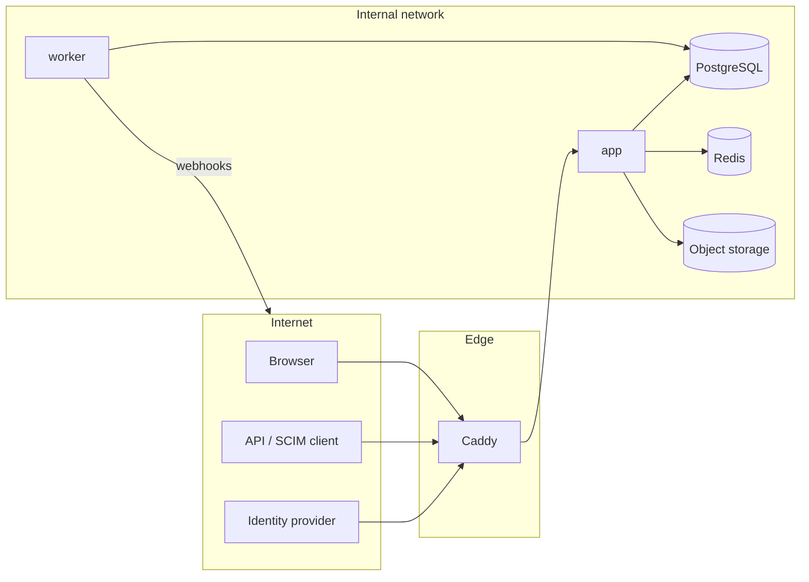

# Threat model (STRIDE, draft)

Status: draft for Phase 0, revisited at the end of every phase and fully reviewed in
Phase 9 against OWASP ASVS 5.0 Level 2.

## Assets

1. Infrastructure documentation of each tenant (topology, addresses, serials, photos).
   Leaks help attackers plan physical and network intrusion.
2. Identities: password hashes, MFA secrets, WebAuthn credentials, sessions, API, SCIM
   and OAuth tokens.
3. Audit log integrity.
4. Instance secrets: Django secret key, database password, IdP keys, webhook secrets.
5. Backups.

## Trust boundaries

Boundaries: internet to Caddy (TLS), Caddy to app (internal network only), app to data
stores (credentials, RLS), tenant to tenant (inside the database), worker to external
webhook targets (SSRF risk).

## STRIDE

| # | Threat | Example | Mitigation | Phase |
|---|---|---|---|---|
| S1 | Spoofing | Credential stuffing | Argon2id, lockout, rate limits per IP and account, MFA, breached password check optional | 1 |
| S2 | Spoofing | Forged SAML assertion, OIDC token replay | Signature validation, audience and issuer checks, nonce, PKCE, replay cache | 7 |
| S3 | Spoofing | Stolen API token | Hashed at rest, scoped, expiring, last use shown, revocable, audited | 7 |
| T1 | Tampering | Cross tenant write via guessed UUID | Policy service on every object, RLS, composite tenant foreign keys | 1 |
| T2 | Tampering | Audit log edited by admin or attacker with DB access | Append only grants, trigger, hash chain, verifier, off host export | 1 |
| T3 | Tampering | Malicious upload (SVG script, polyglot, zip bomb) | Size limits, MIME sniffing, re-encoding, SVG sanitising, no execution path, AV hook | 3 |
| T4 | Tampering | CSRF on state changing HTMX requests | Django CSRF token in `hx-headers`, SameSite cookies | 1 |
| R1 | Repudiation | User denies deleting a rack | Change history with actor, before/after, request id | 1, 6 |
| I1 | Information disclosure | Cross tenant read via search or export | Search and exports use the same scoped selectors; isolation test suite | 1, 6 |
| I2 | Information disclosure | XSS stealing data | Auto escaping, strict CSP without inline script, sanitised rich text | 1 |
| I3 | Information disclosure | Secrets in logs or errors | Structured logging with redaction, no debug in prod, secrets via files | 0 |
| I4 | Information disclosure | Backup theft | Encrypted backups, restricted volume, off site copies encrypted | 9 |
| I5 | Information disclosure | Metrics or health leak internals | Health path blocked at proxy, metrics on internal port | 0, 1 |
| D1 | Denial of service | Expensive trace or report | Depth limits, timeouts, per user export rate limit, background jobs | 4, 6 |
| D2 | Denial of service | Large uploads | Proxy body limit, app limits, streaming to storage | 0, 3 |
| E1 | Elevation of privilege | Editor grants themselves admin | `manage_permissions` required, cannot grant above own rights, audited | 1 |
| E2 | Elevation of privilege | Impersonation misuse | Explicit consent banner, time limited, audited, no impersonation of super admins | 1 |
| E3 | Elevation of privilege | SSRF via webhook URL | Allow list of schemes, DNS resolution check against private ranges, egress proxy option | 7 |
| E4 | Elevation of privilege | Container escape after RCE | Non-root, read only root fs, no shell, dropped capabilities, no-new-privileges | 0 |
| E5 | Elevation of privilege | Supply chain (dependency, action, image) | Lockfile, digest pinning, Renovate, pip-audit, Trivy, CodeQL, signed images | 0 |

## Phase 0 controls in place

* Security headers: HSTS, CSP (`default-src 'self'`, no inline script), nosniff,
  `X-Frame-Options: DENY`, COOP, Referrer Policy; secure, HttpOnly, SameSite cookies.
* Secrets only from environment or Docker secret files; `DJANGO_SECRET_KEY` length check.
* Distroless non-root image, read only root filesystem, dropped capabilities.
* Internal backend network; health endpoints not reachable through the proxy.
* CI: bandit, pip-audit, gitleaks, Trivy, CodeQL, pinned action SHAs.
