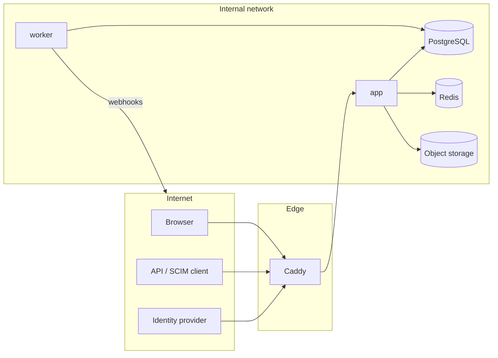

# Threat model (STRIDE, draft)

Status: draft for Phase 0, revisited at the end of every phase and fully reviewed in
Phase 9 against OWASP ASVS 5.0 Level 2.

## Assets

1. Infrastructure documentation of each tenant (topology, addresses, serials, photos).
   Leaks help attackers plan physical and network intrusion.
2. Identities: password hashes, MFA secrets, WebAuthn credentials, sessions, API, SCIM
   and OAuth tokens.
3. Audit log integrity.
4. Instance secrets: Django secret key, database password, IdP keys, webhook secrets.
5. Backups.

## Trust boundaries

Boundaries: internet to Caddy (TLS), Caddy to app (internal network only), app to data
stores (credentials, RLS), tenant to tenant (inside the database), worker to external
webhook targets (SSRF risk).

## STRIDE

| # | Threat | Example | Mitigation | Phase |
|---|---|---|---|---|
| S1 | Spoofing | Credential stuffing | Argon2id, lockout, rate limits per IP and account, MFA, breached password check optional | 1 |
| S2 | Spoofing | Forged SAML assertion, OIDC token replay | Signature validation, audience and issuer checks, nonce, PKCE, replay cache | 7 |
| S3 | Spoofing | Stolen API token | Hashed at rest, scoped, expiring, last use shown, revocable, audited | 7 |
| T1 | Tampering | Cross tenant write via guessed UUID | Policy service on every object, RLS, composite tenant foreign keys | 1 |
| T2 | Tampering | Audit log edited by admin or attacker with DB access | Append only grants, trigger, hash chain, verifier, off host export | 1 |
| T3 | Tampering | Malicious upload (SVG script, polyglot, zip bomb) | Size limits, MIME sniffing, re-encoding, SVG sanitising, no execution path, AV hook | 3 |
| T4 | Tampering | CSRF on state changing HTMX requests | Django CSRF token in `hx-headers`, SameSite cookies | 1 |
| R1 | Repudiation | User denies deleting a rack | Change history with actor, before/after, request id | 1, 6 |
| I1 | Information disclosure | Cross tenant read via search or export | Search and exports use the same scoped selectors; isolation test suite | 1, 6 |
| I2 | Information disclosure | XSS stealing data | Auto escaping, strict CSP without inline script, sanitised rich text | 1 |
| I3 | Information disclosure | Secrets in logs or errors | Structured logging with redaction, no debug in prod, secrets via files | 0 |
| I4 | Information disclosure | Backup theft | Encrypted backups, restricted volume, off site copies encrypted | 9 |
| I5 | Information disclosure | Metrics or health leak internals | Health path blocked at proxy, metrics on internal port | 0, 1 |
| D1 | Denial of service | Expensive trace or report | Depth limits, timeouts, per user export rate limit, background jobs | 4, 6 |
| D2 | Denial of service | Large uploads | Proxy body limit, app limits, streaming to storage | 0, 3 |
| E1 | Elevation of privilege | Editor grants themselves admin | `manage_permissions` required, cannot grant above own rights, audited | 1 |
| E2 | Elevation of privilege | Impersonation misuse | Explicit consent banner, time limited, audited, no impersonation of super admins | 1 |
| E3 | Elevation of privilege | SSRF via webhook URL | Allow list of schemes, DNS resolution check against private ranges, egress proxy option | 7 |
| E4 | Elevation of privilege | Container escape after RCE | Non-root, read only root fs, no shell, dropped capabilities, no-new-privileges | 0 |
| E5 | Elevation of privilege | Supply chain (dependency, action, image) | Lockfile, digest pinning, Renovate, pip-audit, Trivy, CodeQL, signed images | 0 |

## Phase 7 controls in place (SCIM)

* S1: SCIM tokens are random, stored as keyed hashes, revocable and rate limited.
* E1: SCIM never changes super admins, break glass accounts or API clients and
  only manages groups it created, so it cannot grant roles.
* T1: filters run on an allow list of attributes, bounded in size; If-Match
  prevents lost updates.

## Phase 7 controls in place (single sign on)

* S1: OIDC with PKCE, state, nonce and full ID token validation; SAML with signed
  assertions, InResponseTo bound to a signed cookie, replay refused; LDAP with
  escaped filters, no empty passwords and verified TLS.
* E1: providers only link existing accounts of their own domains; provider
  configuration is super admin only; mapped groups follow the provider.
* S2: enforced SSO keeps break glass accounts for emergencies; MFA still applies
  unless the provider is trusted to enforce it.
* I3: pysaml2 loggers are capped so assertions do not reach the logs.

## Phase 7 controls in place

* S1: API tokens carry 256 bits of entropy, are stored hashed, expire, are scoped
  (read, write, tenant) and revocable; OAuth access tokens last one hour.
* E1: API writes run through the domain services; service users never hold MFA
  roles nor reach MFA tenants; rotating a client secret needs the client's rights;
  no tokens while impersonating.
* E3: webhooks reach only public addresses unless allowed, connect to the checked
  address, follow no redirects and use short timeouts.
* T1: webhook payloads are signed (HMAC-SHA256 with timestamp); deliveries are
  queued in the same transaction as the change.
* D1: API throttling per user, OAuth token endpoint rate limited per address.

## Phase 6 controls in place

* R1: history rows are written by database triggers, so no code path changes
  tracked data unrecorded; actor and request id come from the request.
* I1: history, search, exports and PDF reports only show objects the user may view;
  conditional grants fail closed on history; hidden peers are shown as not visible.
* E1: restore needs change permission on the current and the resulting state;
  imports run through the domain services row by row.
* T3: import files are parsed with size, row, cell and decompression limits;
  openpyxl uses defusedxml. Exported cells that a spreadsheet would run as a
  formula are prefixed with an apostrophe.
* D1: exports are rate limited (60 per user per 10 minutes) and capped at 20 000
  rows per table; search fetches at most 200 candidates per type.

## Phase 5 controls in place

* T3: PDF plans are parsed by PDFium (pypdfium2) inside the upload limit; only the
  first page is rendered, at most 6000 pixels per side, and only the PNG is kept.
  Risk accepted for now: a PDFium flaw runs in the web process. Mitigation later:
  rasterise in an isolated worker.
* E1: plan, outline and placement changes need change permission on the floor,
  room, rack or device; moving a device to another room also needs add permission
  there.
* I1: the editor lists only rooms, racks and devices the user may view; the image
  is served through the permission checked attachment download.

## Phase 4 controls in place

* T1: cable ends, VLAN use (untagged and tagged) and WLAN radios are checked by
  triggers to stay inside one tenant; site VLANs only on ports of that site.
* E1: creating a cable needs permission on both end devices.
* I1: traces anonymise hops on devices the viewer may not see.
* D1: traces are bounded (256 hops) and stop on loops.

## Phase 3 controls in place

* T3: uploads accepted by content only; images re-encoded (EXIF, polyglot payloads
  dropped), decompression bomb limit, SVG rebuilt from an allow list (no scripts,
  events, external references), PDFs only as downloads; size limit; optional AV scan
  failing closed.
* I1/I4: uploads encrypted at rest, never addressable by URL; downloads check the
  target object's view permission and use `nosniff` and a sandboxing CSP.
* T1: device trigger keeps devices in their parent's tenant and racks in their rooms,
  forbids other tenants' private types; ports and port templates share their owner's
  tenant; RLS on every new table.
* I2: notes are Markdown without raw HTML, sanitised by nh3 after rendering.
* E (format string): naming patterns only substitute `{n}`; no `str.format`.

## Phase 2 controls in place

* T1: hierarchy trigger rejects cross tenant parents and forged scope paths; RLS on
  every tree table; site moves rewrite subtree, rack space and assignments atomically.
* T1: rack space overlap and bounds enforced in the database (exclusion constraint,
  triggers), not only in the UI.
* I2: map popups and SVG labels are built as text, never as HTML.
* I (privacy): map tiles are third party requests from the browser; configurable or
  disabled (ADR 0014). No server side geocoding.

## Phase 1 controls in place

* S1: Argon2id, account lockout, per IP limits, TOTP/WebAuthn/recovery codes, MFA
  enforcement per role and tenant, no user enumeration by message or timing.
* T1/I1: policy engine on every view and service; RLS (`FORCE`) with a non-superuser
  role; tests with application filtering bypassed.
* T2/R1: hash chained, append only audit log (trigger blocks UPDATE, DELETE, TRUNCATE).
* T4: CSRF tokens on all forms and HTMX requests; `__Host-` cookies.
* E1: no escalation when granting, last super admin protected, system roles immutable.
* E2: impersonation limited, time boxed, bannered and audited.
* I3: MFA secrets encrypted at rest (Fernet, rotatable keys); tokens stored hashed.
* Open redirect protection on login and tenant switch; CSV formula neutralisation.

## Phase 0 controls in place

* Security headers: HSTS, CSP (`default-src 'self'`, no inline script), nosniff,
  `X-Frame-Options: DENY`, COOP, Referrer Policy; secure, HttpOnly, SameSite cookies.
* Secrets only from environment or Docker secret files; `DJANGO_SECRET_KEY` length check.
* Distroless non-root image, read only root filesystem, dropped capabilities.
* Internal backend network; health endpoints not reachable through the proxy.
* CI: bandit, pip-audit, gitleaks, Trivy, CodeQL, pinned action SHAs.
